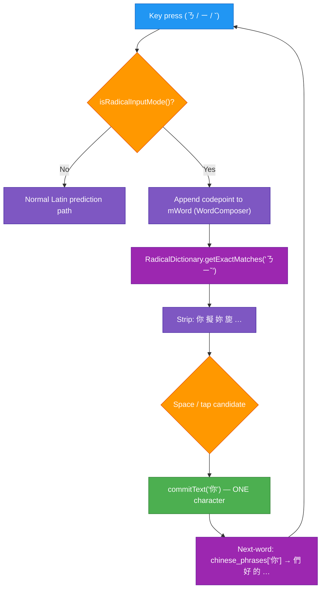
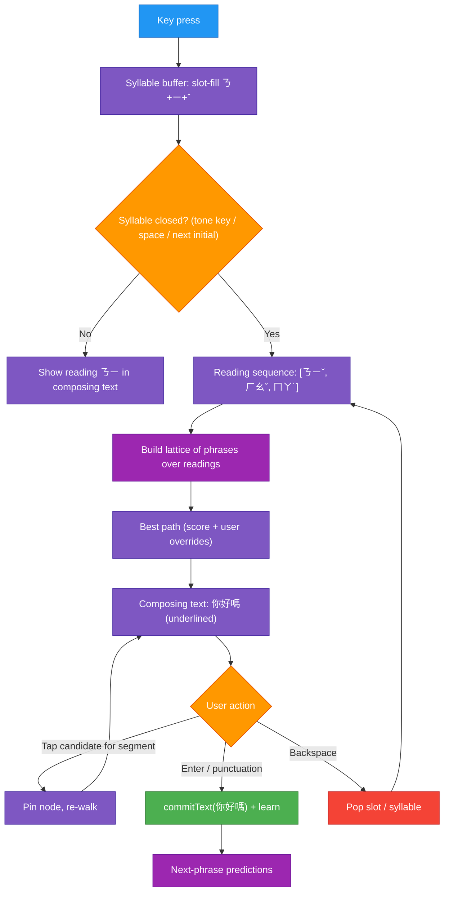
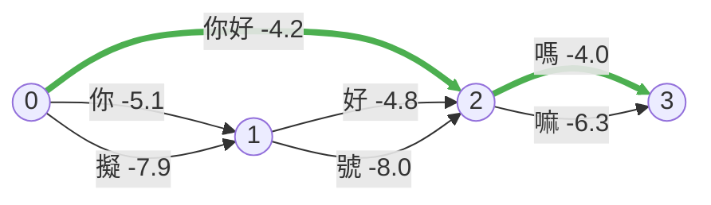
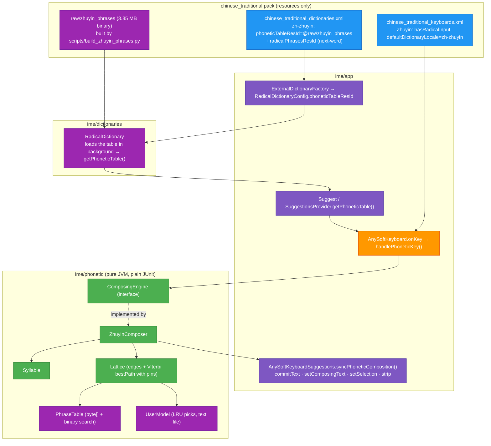
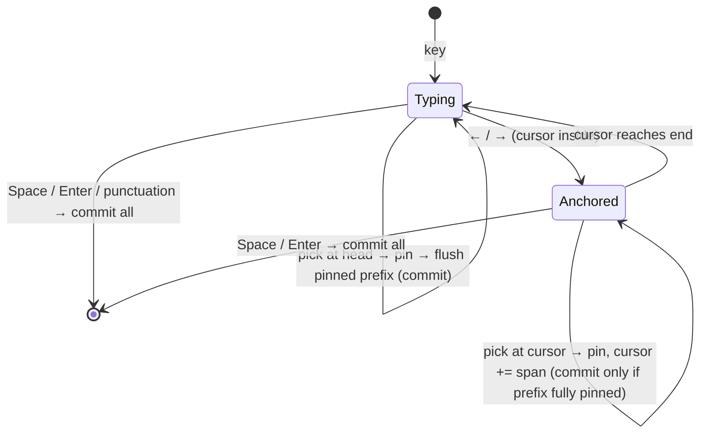
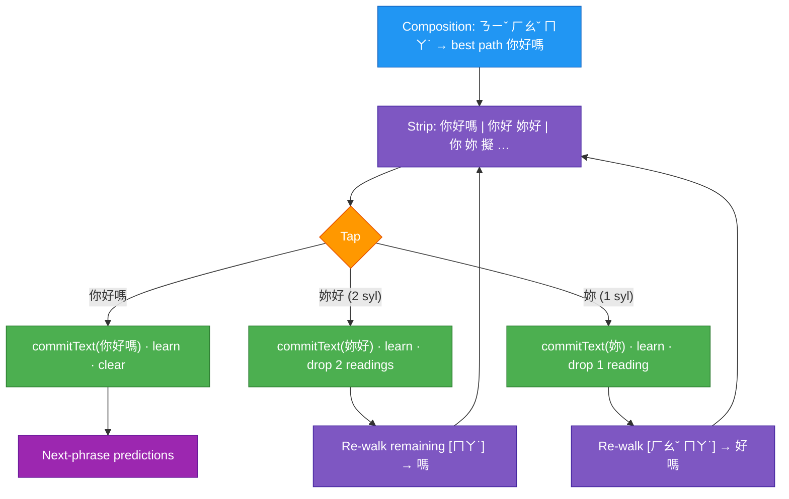
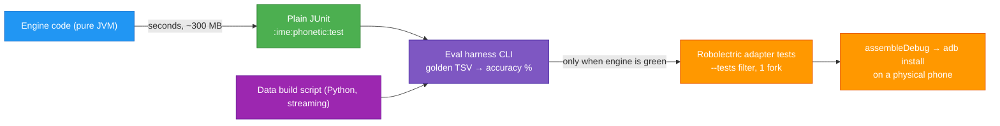

# TASK-001: Smart Zhuyin (Bopomofo) input
Created using task template in docs/tasks/task_template.md

## Full initial request (verbatim)

> Great. Now task: Add zhuyin/bopomofo support. Think of how it could be achieved, create flow charts and more. It's ok to also run small pred models on phone. So it's ok to add some library to support it. One note - this dev machine is super smol - only 8GB of RAM. So things may be OOMed. Be aware of it. Think of how dev and testing could be done on so little RAM. Gl hf, keep it elegant. Feel free to now just focus on architecture in a new task_001 progress file. Evaluate them.

## Overview

AnySoftKeyboard **already ships a Zhuyin keyboard**, inside the `chinese_traditional` pack
(`addons/languages/chinese_traditional`, commit `c0494f702` and follow-ups). It is a
**per-character table lookup**. You type one full syllable (ㄋㄧˇ), the strip shows every
character with that reading (你 擬 妳 …), and space commits one character. This is roughly
where Taiwanese IMEs were in the 1980s. Modern Zhuyin IMEs (McBopomofo, libchewing, phone
keyboards) are **phrase- and sentence-level**. You type a whole run of syllables (ㄋㄧˇㄏㄠˇㄇㄚ˙),
the engine converts the run to the most likely Hanzi sentence (你好嗎), and you only fix the
segments it got wrong.

The task, then, is not "add Bopomofo". It is **adding a phonetic conversion engine**
(syllable buffer → word lattice → best path → candidate correction → learning) and wiring
it into the IME as a composition mode. This file evaluates architectures for that, plus how
to develop and test it on an 8 GB dev machine.

## User decisions (precise wording)

| Topic | Decision (user's words) |
|---|---|
| Models / libraries | "It's ok to also run **small pred models on phone**. So it's **ok to add some library** to support it." → a 3rd-party lib is pre-approved *in principle*; the specific lib still gets confirmed before use (AGENTS.md) |
| Dev constraints | "this dev machine is super smol - **only 8GB of RAM**. So things may be OOMed. Be aware of it." |
| Scope of this step | "Feel free to now **just focus on architecture** in a new task_001 progress file. **Evaluate them.**" |
| Style | "**keep it elegant**" |
| Architecture | "**B looks good.**" → B (pure-JVM lattice engine) + I2 (`ComposingEngine` seam) |
| Simplified Chinese | "**Simplified not necessary.**" → no zh-CN output in v1 |
| Commit granularity | "Ideally commiting could be done **not just per character, but also per multiple chars**." → see *Commit model* below |
| Inspiration | "Feel free to check projects **../zhuyin-anywhere** and **/rnote** and **/zhuyin-yt** projects for inspiration." → `../zhuyin-anywhere`, `../rnote`, `../yt-zhuyin` (see *Inspiration*) |
| Old per-char dictionary | "1. **Sure.**" → replaced. `zhuyin_radicals` is deleted; every single character (McBopomofo `BPMFBase`, ~13k chars) is inside the new phrase table, so no separate fallback is needed |
| Layout | "Huh? Idk whats Dachen layout. **Use bopomofo.**" → 大千 *is* the standard Bopomofo key arrangement (already in `qwerty_zhuyin.xml`), so v1 = that layout only |
| Commit + cursor | "3. **Both**, as is required to be elegant imho" → left-to-right commits **and** cursor editing in v1, via one rule (see *Commit model*) |
| Candidates panel | "Would be cool to also be able to **open a window of all options, similar like gboard**, not just scrollable at the top" → subtask 1.10. Pick: "**Both**" (▾ expand arrow at the strip end **and** swipe up on the strip open a grid of all candidates) |
| Zhuyin before commit | "Also allow to **not turn into chinese characters before commiting - show and allow to edit zhuyin** or kind of undo. Kind of like iphones do I think." → subtask 1.11. Pick: "**Zhuyin inline**": the field shows the typed Bopomofo (editable symbol by symbol), the strip shows the Hanzi, space/pick converts |
| Own settings in dev | "read my existing anysoftkeyboard settings and languages, set to use those in the dev build too. **No need for hacker or LT with row.**" → the store app's prefs copied (read-only) into the dev copy; 注音 on; Hacker ×3 and Lithuanian 4-rows off |
| Spacebar cursor | "Also **allow to use spacebar to scroll the cursor**, kinda like gboard or iphone." → subtask 1.13: new setting "Slide on space bar moves the cursor" (default off; on in the user's dev copy) |
| Autocorrect | "I also have disabled autocorrect as it sucks in Lithuanian and English. **Can we keep it on per language only?**" → subtask 1.12 (Zhuyin does not depend on the global switch) |
| Dev keyboard default | "Also **no need to ever reset to non-dev**." → the dev IME stays the phone's default |
| Stress test | "Also do some tests, such as writing something, cancelling something, cancelling commiting, maybe deleting, going back and forth, switching languages and see if any bugs pop up." → 15 IME scenario tests + an on-device pass; bugs found and fixed are listed under *Stress-test findings* |
| Comma/dot | "You still have not moved comma nad dot out of hte main layout, can you do it?" → ， and 。 removed from 大千 rows 2-3 (now 10 wider keys each); they live in the bottom row |
| Theme | "It's ok, we can switch to other theme on dev" / "your selected theme is terribly disgusting … full of blue and green" → dev copy uses Yochees Dark 2 (neutral, draws hints) instead of Power Saving (hint size 0px) |
| 26-key rows | "26 char keyb should keep some special butons as qwerty lol, now it looks a bit weird and useless" → row 3 = ⇧ z…m ⌫ like QWERTY; ⇧+letter types Latin capitals (the engine only takes lowercase) |
| z hint | "where's the Z lol? Under Fo it's weird" → the ㄈ key's hint was 符; now z |
| 大千 split | "Make zhuyin two options - with and without big comma and dot inside the letter section" / "I mean split main one into two" → 注音 (bottom-row ，。 only, keeps its id) + new 注音 ，。 (also in rows 2-3) |
| Ortholinear 注音 | "I like keys being ortholinear" (picked the 4×10 grid mockup) → 注音 = four rows of ten equal keys in aligned columns; ㄦ and ⌫ in the bottom row; ？ on long-press ，, 「 on long-press 。 (注音 ，。 keeps the classic rows) |
| Wording | "Don't mention gboard like grid in task file or the code pls" → no references to other keyboards in code, XML or this file's own text (user quotes stay verbatim) |
| Dot position | "I dislike spacebar placement, move big dot to the left of it pls" → bottom row ☺ ， 。 [space] ㄦ ⌫ ⏎ |
| Bug report | "Top two rows on main keeb layout on hold have wrong chars. Like Bo has Q and 1, but Pho has Bo lol." → long-press on every Bopomofo key now gives exactly its hint (digit or Latin key), on both 大千 keyboards |
| Bug report | "Suggestions don't appear without tones." → the open syllable is converted provisionally (toneless) and offered in the strip; a pick covering it closes it first |
| Bug report | "If I type wrong bopoofo chars, nonexistant words, they can replace first char. Why and how?" → cause: an earlier-slot symbol replaced that slot when the syllable was not a real one (ㄋㄧㄛ + ㄅ → ㄅㄧㄛ); now only the last typed slot of an incomplete syllable is corrected in place, anything else starts a new syllable |
| Raw Bopomofo | "Also should allow to type in standalone bpm character. WDyt? Like others" → the anchor syllable's own Bopomofo is the last candidate (Kind RAW, never learned); unknown syllables' Bopomofo fallbacks are RAW too |
| CI build | "Can we push a build to gh somehow?" … "want" (a manual workflow for installable dev APKs) → `.github/workflows/zhuyin-dev-apk.yml` (workflow_dispatch): builds the `.zhuyindev` keyboard + the Chinese pack, signed with the repo's `.github/actions/deploy/debug.keystore` (stable across runs), artifact `zhuyin-dev-apks` |
| Layouts / punctuation | "Also the punctuation on the bottom can also be replaced maybe. What are some common bopomofo layouts? Could be maybe one of the layout options" → subtask 1.14. Picks: layouts "**Does it really hurt to do most common ones?**" → Standard 大千 + 許氏 Hsu 26 + 倚天 ETen 41 + 倚天26 ETen 26; bottom row "**Maybe ?, big comma, space, big dot, quotation**" → ？ ， [space] 。 「 (popups for more); "**can we show numbers and latin letters as outlines or something on the keeb?** So that you know where to look for a latin character" → faint Latin/digit hint on every key |
| Device testing | "I have android phone which I can connect via **wireless adb** maybe." / "Maybe **tell me how to connect later, when it is ready for testing**" → give wireless-adb steps at subtask 1.8 |

## Design principles
- **No backwards compatibility** - Clean implementation, update all code in place
- KISS
- Elegant
- No new 3rd-party dependencies without explicit user approval (ask before implementing a solution that needs one)
- **Engine is pure JVM** (no `android.*` imports). It can then be tested and evaluated without Robolectric, the emulator or AGP, which is what makes the 8 GB machine workable.
- **Phone memory budget:** the engine plus its data stays at **≤ ~10 MB of resident heap**. The IME process is long-lived and gets killed under pressure.

---

## Current analysis

### What exists today

| Piece | Where | Notes |
|---|---|---|
| Dachen (大千) layout | `addons/languages/chinese_traditional/pack/src/main/res/xml/qwerty_zhuyin.xml` | Keys emit Bopomofo codepoints U+3105..U+3129 + tones ˇˊˋ˙. No shift. |
| Reading → chars table | `pack/src/main/res/raw/zhuyin_radicals` (53 KB) | `ㄅㄚˇ\t把鈀靶`: **single characters only**, keyed by a full syllable *with* tone |
| Char → Zhuyin | `pack/src/main/res/raw/chinese_char_to_zhuyin` | used by Boshiamy homophone lookup |
| Next-word phrases | `pack/src/main/res/raw/chinese_phrases` (27.9k lines) | `一\t個`: first char → remainder, **no readings**, derived from McBopomofo `phrase.occ` (MIT) |
| Engine | `ime/dictionaries/.../RadicalDictionary.java` (1529 lines) | Generic "radical code → candidate list" engine shared by Boshiamy / Cangjie / Zhuyin; data held in Java maps |
| IME wiring | `ime/app/.../ime/AnySoftKeyboardSuggestions.java` (`isRadicalInputMode()`, `commitPendingRadical()`, selector-key promotion …) | "Radical mode": `mWord` holds the typed code, space commits the top candidate, one char per composition |
| Config plumbing | `DictionaryAddOnAndBuilder`, `ExternalDictionaryFactory`, `RadicalDictionaryConfig`, `KeyboardAddOnAndBuilder` (`hasRadicalInput`, `radicalKeyCharacters`) | Packs are **resource-only APKs**. All code lives in `ime/`, packs ship XML + raw data |

### Current Flow



### What needs improving

1. **One character per composition.** Typing 你好嗎 takes 3 syllables, 3 candidate picks and
   3 commits. Real users type whole phrases and pick only when the engine is wrong.
2. **No multi-syllable phrase data with readings.** `chinese_phrases` has no Zhuyin, so
   ㄋㄧˇㄏㄠˇ can't become 你好 directly.
3. **Tone is mandatory and syllable boundaries are implicit.** Real Dachen behaviour is that a
   tone key (or space = 1st tone) *closes* a syllable, and typing a new initial/medial/final
   *replaces* the slot already filled. Users also skip tones. The radical engine treats the
   input as an opaque string.
4. **No ranking context.** Candidates are ordered by single-character frequency, so homophones
   (是/事/市/式 for ㄕˋ) aren't disambiguated by neighbours.
5. **No learning.** Picking 事 after ㄕˋ never changes the next ranking.
6. **Radical mode is already very complex** (selector keys, promoted candidates, popup
   routing). Stacking sentence composition on top of it would make
   `AnySoftKeyboardSuggestions` worse.

Target flow (engine-agnostic):



Lattice for ㄋㄧˇ ㄏㄠˇ ㄇㄚ˙ (each edge is a phrase covering 1..n syllables; best path in green):



---

## Inspiration (user's sibling projects)

| Project | What's relevant | What we take |
|---|---|---|
| `../yt-zhuyin` | `build_zhuyin_dict.py` builds a reading dict from McBopomofo `BPMFMappings.txt` + `phrase.occ` + `BPMFBase.txt` + `heterophony{1,2,3}.list` (download recipe in its README). `src/10-segment.js` does **unigram max-likelihood segmentation**, `maxLen = 6`, `score = log(freq+1) − log(total)`, unknown char ≈ −14 | The **same data recipe** for `zhuyin_phrases.bin` (preferred reading first, heterophony ordering, particle overrides like 嗎→ㄇㄚ˙). The **same scoring formula** for the Viterbi walker: the IME runs that segmenter in the reading → text direction. `maxLen = 6` confirmed |
| `../zhuyin-anywhere` | Reuses yt-zhuyin's dict + segmenter. Documents the known data quirk that **McBopomofo stores dictionary tones, not neutral ˙** (覺得 = ㄉㄜˊ). Has a Node test harness | **Tone fuzzing**: a typed ˙ also matches the full-tone reading and vice versa, scored with a small penalty. Otherwise users typing textbook ˙ get no match |
| `../rnote` | On-device ONNX inference via `ort` (PP-OCRv5 mobile, Apache-2.0), with a custom zhuyin output head | A precedent and know-how for phase 2 (D): if a neural reranker is ever added, **ONNX Runtime** is the runtime already proven in the user's stack |

**Golden-set caveat:** generating eval pairs (text → reading via the yt-zhuyin segmenter →
expected text) uses the same dictionary the engine converts with. So it measures
**homophone/segmentation disambiguation**, not reading-data correctness. That is acceptable,
because disambiguation is what the engine adds. The corpus text must be licence-clean
(e.g. zh-TW Wikipedia sentences, CC BY-SA, used only for eval and never shipped).

## Chosen solution: B + I2

**Why this over alternatives.** Rejected: A (greedy, bloats the shared `RadicalDictionary`,
30–50 MB heap), C (Rust + LGPL + JNI on an 8 GB box), D (a native dependency and training
pipeline before we know they're needed; kept as phase 2) and E (hallucinations, no per-segment
correction). B scored 33 against 25/25/25/15 and is the only option whose whole engine
develops and tests without Android.

### Chosen solution implementation details (as built)



Key design points (as built; changes from the draft are noted):
- **Syllable encoding**: `base = (initial*4 + medial)*14 + final` (≤ 1231), tone 0..5 kept
  separately (0 = not typed). The same formula lives in `Syllable.java` and
  `build_zhuyin_phrases.py`, and both test suites pin it.
- **Phrase table keyed by toneless syllables**: each entry stores its tones (3 bits per
  syllable). A typed tone filters, and a missing tone matches everything. *(Draft said "key
  range by tone bits". That only works for the last syllable, so the tones moved into the
  entries.)* Typing ˙ also matches full tones at a −3 penalty, because McBopomofo stores
  dictionary tones (覺得).
- **Binary data read into one `byte[]`** (3.85 MB) and searched in place. *(Draft said
  `noCompress` + `openRawResourceFd`. Reading the stream works whether or not aapt compresses
  it, so it is simpler and just as small.)*
- **Data**: McBopomofo `BPMFMappings.txt` (phrases), `BPMFBase.txt` (chars), `phrase.occ`
  (counts), heterophony lists (primary readings) and particle overrides (嗎→ㄇㄚ˙), the recipe
  from `../yt-zhuyin`. Kept only BMP text whose length equals its syllable count (so 1 char =
  1 syllable) and phrases of at most 6 syllables, and dropped bare Bopomofo symbols. Score =
  `ln((occ+1)/total)`, with secondary readings ×0.05 (chars) / ×0.3 (phrases). 104,875 keys and
  159,911 entries.
- **No `KeyLayout` class** *(dropped from the draft)*. The keyboard XML already emits Bopomofo
  code points (and the physical-keyboard mapping does too), so the engine only sees Bopomofo.
- **Typing**: a tone key, or space for 1st tone, closes a syllable. A symbol for a filled or
  earlier slot replaces it, unless the syllable so far is a known syllable, in which case it is
  closed without a tone (tones are optional). A tone right after a closed syllable re-tones it.
- **Integration**: the Zhuyin dictionary is still a `RadicalDictionary`, but with
  `phoneticTableResId` instead of a radical table. That reuses all the existing gating
  (password fields, symbols keyboard, keyboard switch commits, strip visibility) and the
  next-word phrases. `isPhoneticInputMode() = isRadicalInputMode() && table loaded`. The old
  per-char `zhuyin_radicals` table and its generator are deleted.
- **Field sync**: one method mirrors the engine after every event: commit text → composing
  text → cursor (via a tracked absolute composing start, because `setComposingText` cannot place
  the cursor inside) → strip (or next-word suggestions after a commit).
- **Learning**: `UserModel` (1024-entry LRU, +12 log-score bonus per pick) is saved to
  `files/zhuyin_user_model.txt` on `onFinishInput`. It is off while `Suggest` is in incognito.

### Commit model: per character, per word or per sentence

**One rule covers both left-to-right commits and cursor editing** (user decision 3: "Both"):

> The composition has a **cursor** (0..n syllables, default = end). The **anchor** is the
> cursor when it sits *inside* the composition, otherwise the first unpinned syllable.
> The strip shows candidates **starting at the anchor**. **Picking pins** that phrase in the
> lattice and moves the cursor past it. **Any pinned prefix is committed immediately.**
> Space / Enter commit everything.

So without touching the cursor, the anchor is the head and every pick is a left-to-right
commit. After moving the cursor (← / →: ASK's existing `KeyCodes.ARROW_LEFT/RIGHT`, also
sent by space-bar swipes, routed to the engine while composing), a pick *fixes a middle
segment without committing*. Typing and backspace act at the cursor, and Viterbi re-walks
around the pins. That one rule gives both behaviours, with no special modes.



Default view (cursor untouched, anchor = head):

| Strip slot | Example (typed ㄋㄧˇㄏㄠˇㄇㄚ˙) | Tap = |
|---|---|---|
| 1st: whole best path | **你好嗎** | commit all 3 syllables |
| next: phrases starting at the head, longest first | 你好 · 妳好 · 擬好 | commit that phrase (2 syllables). The rest (ㄇㄚ˙ → 嗎) **stays composing** and is re-walked |
| next: single chars at the head | 你 · 妳 · 擬 · 尼 … | commit 1 character. The rest stays composing |
| Space / Enter (closed syllable, no pick) | — | commit the whole best path |

So the user can commit **one character, one word, or the whole sentence** with one tap, and
any wrong segment is fixed by committing the right words left-to-right. Each pick is learned
(`UserOverrideModel` key: previous committed phrase + head reading → picked phrase), so the
next walk prefers it. With the cursor moved to ㄏㄠˇ, the strip shows 好 · 號 · 好嗎 …, and
picking 號 pins it **without committing** (你 is still unpinned): the composition becomes
你號嗎, still editable.



`ComposingEngine` API (as built, `ime/phonetic/.../ComposingEngine.java`). After every call
the IME commits `takeCommitText()`, shows `composingText()` with the cursor at
`cursorCharOffset()`, and fills the strip with `candidates()`:

```java
interface ComposingEngine {
  boolean onKey(int codePoint);   // Bopomofo + space; false = not used (IME commits, then handles it)
  boolean onDelete();             // slot → syllable before the cursor; false when empty
  boolean moveCursor(int delta);  // false at the edges (IME then commits and moves normally)
  void pick(Candidate c);         // pin at anchor; a pinned prefix goes to takeCommitText()
  void commitAll();
  void reset();
  boolean isComposing();
  String takeCommitText();
  String composingText();
  int cursorCharOffset();
  List<Candidate> candidates();   // [SENTENCE (if > 1 segment and anchor = start), PHRASEs longest first]
}
```

**Edge cases** (all covered by `ZhuyinComposerTest` unless noted):
- **Unknown syllable (ㄅㄩ):** shown as its Bopomofo text through a fallback edge, so a path always exists.
- **Lone initial followed by another initial (ㄋ→ㄇ):** the new one replaces it.
- **Backspace:** removes slots, then syllables. At the start of the composition it is consumed. Pins it touches are dropped.
- **Empty composition:** space and Enter are not consumed, so a real space or new line is typed.
- **Keyboard switch or symbols keyboard:** commits the converted text (`commitPendingRadical`). Not unit-tested in the IME, see 1.6.
- **Field closes:** converts and commits in place (`abortCorrection…`, which also covers orientation changes).
- **User taps elsewhere:** the shown text is kept and the cursor is not moved back (`onUpdateSelection`).
- **More than 20 syllables:** the head segment is committed automatically.
- **Punctuation, popup digits and Shift/Ctrl:** a non-Bopomofo key commits first, then is handled normally. Shift+Enter and Ctrl combinations bypass the engine.

## Developing & testing on 8 GB RAM

This was measured at the start of the task: 7.6 GiB total, ~1.7 GiB available, swap already
4.3 GiB in use, 4 cores. **The project defaults would OOM**: `gradle.properties` sets
`org.gradle.jvmargs=-Xmx8000M` and `gradle/android_unit_test.gradle` sets test-JVM
`maxHeapSize = "4096m"`. No emulator is installed and no device is attached (`adb devices`
is empty).



1. **Most work never touches Android.** The engine module is a plain `java-library` (no AGP),
   so `./gradlew :ime:phonetic:test` configures fast and runs plain JUnit in a few hundred MB.
   That covers ~90% of the task's code.
2. **User-level Gradle overrides** (`~/.gradle/gradle.properties` takes precedence over the
   project file, so no repo change is needed):
   ```properties
   org.gradle.jvmargs=-Xmx2g -XX:+UseParallelGC
   kotlin.daemon.jvmargs=-Xmx768m
   org.gradle.parallel=false
   org.gradle.workers.max=2
   ```
   Run Robolectric tests with `-DmaxTestForks=1` and always with `--tests` in `:ime:app`.
   The 4096m test heap is a ceiling, not a reservation, so it's fine with 1 fork.
3. **Fence builds so the OOM killer hits the build, not the desktop:**
   `systemd-run --user --scope -p MemoryMax=5G -p MemorySwapMax=2G ./gradlew …`
4. **One JVM tool at a time.** Run `./gradlew --stop` before Bazel (`bazel run //:format`) and
   `bazel shutdown` after. Optionally, in `~/.bazelrc`: `startup --host_jvm_args=-Xmx1g` and
   `build --local_resources=memory=HOST_RAM*.4 --jobs=2`. Close Android Studio while
   building, since it alone takes 2–3 GB.
5. **Offline eval harness instead of manual phone testing** (as built: `ConversionEvalTest`).
   `zhuyin_eval.tsv` holds 83 everyday sentences (`scripts/zhuyin_eval_sentences.txt`,
   converted to readings by the data script). The test types each one, prints the sentence and
   char accuracy plus every miss, and fails below 90% / 97%. Baseline: **95.2% sentences
   (79/83), 98.9% chars**. All 4 misses need context (叫/較, 再/在, 夜市/業是, 祝/助), which is
   what phase-2 bigrams would fix. Growing the sentence list is the cheapest quality lever.
6. **Data scripts stream.** The Python build reads source files line by line and writes the
   binary incrementally, so it never holds the corpus in memory. Raw downloads go in `scratch/`.
7. **No emulator** (it needs 2–4 GB). Use a physical phone via USB or wireless `adb pair`, and
   install only what changed: `:ime:app:installDebug` and the chinese_traditional `apk`
   module's `installDebug`.
8. **If D is ever chosen:** train the tiny model off-machine (Colab/Kaggle), or on CPU here
   with a model under 3 M params and a small batch. Only the exported int8 file enters the repo.

## Open questions for the user

1. ~~Pick an architecture~~ → B + I2 (decided).
2. ~~Replace or keep the per-char Zhuyin dictionary~~ → replaced; single chars live in the new table (decided).
3. ~~Layouts for v1~~ → the standard Bopomofo layout (大千, the one printed on Taiwanese keyboards and already in `qwerty_zhuyin.xml`). Others (倚天 ETen, 許氏 Hsu) are out of scope (decided).
4. ~~Simplified output~~ → not needed (decided).
5. ~~Commit model~~ → both left-to-right commits and cursor editing, unified by the pin + flush-prefix rule (decided).

## Subtasks

| ID | Description | Status | File |
|----|-------------|--------|------|
| 1.0 | Architecture evaluation | ✅ B + I2 chosen | this file |
| 1.1 | Dev env: `~/.gradle/gradle.properties` (2 GB heap, 1 worker), `~/.bazelrc` (1 GB), JDK 21, no-Gradle inner loop `scratch/phonetic_test.sh`, Gradle verified on `:ime:phonetic` | ✅ | — |
| 1.2 | Data pipeline: McBopomofo → `zhuyin_phrases` + eval TSV, with Python tests | ✅ | `addons/languages/chinese_traditional/scripts/build_zhuyin_phrases{,_test}.py` |
| 1.3 | Engine core: `Syllable`, `PhraseTable`, `Phrase` | ✅ | `ime/phonetic/src/main/java/com/anysoftkeyboard/phonetic/` |
| 1.4 | `Lattice` (Viterbi + pins) + `ZhuyinComposer` + eval baseline | ✅ 95.2% / 98.9% | same |
| 1.5 | `UserModel` (learning, incognito-aware, persisted) | ✅ | same |
| 1.6 | IME seam: config attr, `RadicalDictionary` table loading, `Suggest.getPhoneticTable()`, key routing, field sync, picks, lifecycle | ✅ written and type-checked; ⚠️ **not yet run under Gradle/Robolectric**, and no IME-level phonetic test yet | `ime/app/.../AnySoftKeyboardSuggestions.java`, `AnySoftKeyboard.java` |
| 1.7 | Pack: dictionary entry, old `zhuyin_radicals` removed, README/NOTICE | ✅ | `addons/languages/chinese_traditional/` |
| 1.8 | Gradle build + Robolectric run, formatting, on-device test over wireless adb + screenshots (see *On-device testing*) | 🔄 in progress | |
| 1.9 | (phase 2) bigram LM → measure → neural reranker (D) if needed | ⏳ optional | |
| 1.10 | Expanded candidate panel: ▾ arrow + swipe-up open a grid of all candidates | ✅ `CandidatesPanelView`, `ExpandCandidatesAction`, 3 IME tests, verified on device | `keyboards/views/CandidatesPanelView.java` |
| 1.11 | Zhuyin inline: composition shows Bopomofo (pinned segments as Hanzi), backspace edits symbol by symbol, backspace after a pin undoes it (and its learning) | ✅ verified on device; also fixed the "ㄋㄧˇㄏ loses ㄏ" report (no longer reproduces with the user's settings) | `ZhuyinComposer.java` |
| 1.12 | Per-keyboard (per-language) autocorrect switch | ⏳ | |
| 1.13 | Spacebar slide moves the cursor, setting in Gestures; suppresses space-bar swipe left/right while on | ✅ `PointerTracker` + 2 view tests | `keyboards/views/PointerTracker.java` |
| 1.14 | Layouts: + 許氏 Hsu 26, 倚天 ETen 41, 倚天26 ETen 26 (`KeyLayout` strategy, 12 tests); bottom row ？ ， space 。 「; Latin/digit hints on keys | ✅ verified on device (Hsu typing 你好, ETen layout) | `KeyLayout.java`, `qwerty_zhuyin_*.xml` |

## Verification status

| Check | Result |
|---|---|
| `ime/phonetic` unit tests (42) incl. eval, via `scratch/phonetic_test.sh` (javac + JUnit, ~135 MB RSS, 3 s) | ✅ all pass. Log: `scratch/test_runs/` |
| `./gradlew --configure-on-demand :ime:phonetic:test` (real build, Error Prone `-Werror`, JDK 21 at `~/.local/share/jdks/jdk-21.0.13+9`) | ✅ BUILD SUCCESSFUL, 42/42, 12 s warm |
| Python: `build_zhuyin_phrases_test` (6) + existing `boshiamy_variants_test` (39) | ✅ 45 pass |
| `RadicalDictionary.java` compiled against API-16 `android.jar` + androidx.annotation | ✅ no errors |
| `ime/app` changed files type-checked the same way (errors only for absent R/BuildConfig/Rx/androidx classes, none in the new code) | ✅ partial check |
| `:ime:dictionaries:testDebugUnitTest` | ✅ 94/94 |
| `:ime:app` `AnySoftKeyboardPhoneticTest` (new, 9) + `RadicalDictionaryConfigTest` + `SuggestionsProviderTest` | ✅ 37/37, after fixing double-space→period eating a committed char |
| Formatting | ✅ google-java-format 1.25.2 (the exact jar `//:format` pins, sha256 verified) on all changed Java files. Bazel itself isn't installed |
| On-device typing (Xiaomi 25010PN30G, Android 15; dev copy `…zhuyindev` side by side, real install untouched) | ✅ conversion, head-phrase pick, toneless typing, cursor pick, Enter commit. Screenshots `scratch/screenshots/07…13_*.png` |
| `:ime:app` regression: `com.anysoftkeyboard.ime.*` + `com.anysoftkeyboard.AnySoftKeyboard*` (minus `StartUpAllSdkTest`) | ✅ 37 classes, 589 tests, 0 failures |
| Full regression after layouts + stress fixes: phonetic + dictionaries + ime.* + AnySoftKeyboard* + keyboards.* + dictionaries.* | ✅ 1156 tests, 0 failures (7 skipped as in repo) |

**Follow-up for 1.8:** add a Robolectric IME test (e.g. `AnySoftKeyboardPhoneticTest`) that
feeds Bopomofo key codes through `TestableAnySoftKeyboard` with a Suggest whose
`getPhoneticTable()` returns the real table. It should assert the composing text, a head-phrase
pick commit, Enter commit, a keyboard-switch commit and deletion. The repo has no radical-mode
IME tests to copy, so this needs the SDK to iterate on.

## On-device testing (safe, side-by-side install)

**Rule: never touch the user's installed AnySoftKeyboard or its settings.** Debug builds
use the same app id as the store app (`com.menny.android.anysoftkeyboard`). Installing one over
the real install fails on the signature, and the usual "fix" (uninstall) wipes the user's
settings and dictionaries. So:

- Build the keyboard with a **separate app id** through the init script
  `.github/zhuyindev.init.gradle`, which sets `applicationIdSuffix '.zhuyindev'` on `:ime:app`
  debug. A suffix, not `-Poverride_app_id`: that one also renames the R namespace and breaks the
  build. It is a separate app with separate data; provider authorities follow
  `${applicationId}`, and the app declares no `<permission>` or `sharedUserId`, so nothing
  clashes.
  ```
  ./gradlew --init-script .github/zhuyindev.init.gradle :ime:app:assembleDebug \
      :addons:languages:chinese_traditional:apk:assembleDebug
  ```
- The Traditional Chinese pack is not on the Play Store, so its default id
  (`com.anysoftkeyboard.languagepack.chinese_traditional`) is new on the phone. Both keyboard
  apps can see it, which is harmless.
- Install only with `adb install -r <apk>`. **Never** `adb uninstall`, `pm clear` or
  `installDebug` without the init script, and never install anything under
  `com.menny.android.anysoftkeyboard` itself.
- The user enables "AnySoftKeyboard (dev)" in Android's keyboard settings and switches to it
  with the keyboard picker. Switching back to the real AnySoftKeyboard restores everything
  as it was. Afterwards, `adb uninstall com.menny.android.anysoftkeyboard.zhuyindev` removes
  **only** the dev copy (ask first).
- Screenshots: `adb exec-out screencap -p > scratch/screenshots/<name>.png`. No emulator: its
  system image (~1 GB) and RAM (2–4 GB) don't fit this machine.

**Connecting the phone over wireless adb** (Android 11+, commands work in fish too):
1. Settings → About phone → tap *Build number* 7× to unlock Developer options.
2. Settings → System → Developer options → **Wireless debugging** → on.
   - The phone and the PC must be on the same network. While the phone *hosts* the hotspot,
     some phones grey this out ("connect to Wi-Fi"). Then use a USB cable once:
     `adb tcpip 5555`, unplug, `adb connect <phone-hotspot-ip>:5555`. The IP is usually the
     PC's default gateway: `ip route | grep default`.
3. Tap **Pair device with pairing code**. It shows `IP:PORT` and a 6-digit code.
4. On the PC: `! adb pair IP:PAIR_PORT` (enter the code), then `! adb connect IP:PORT` with the
   port from the main Wireless debugging screen (it differs from the pairing port).
5. `! adb devices` should list the phone as `device`.

## Stress-test findings (fixed)

| # | Symptom | Cause | Fix |
|---|---|---|---|
| 1 | Closing the field left "ㄋㄧˇㄏㄠ你好" (Bopomofo + conversion) | `InputMethodService.onFinishInput` finishes the composing text before our hook, so committing after it appends | commit the composition at the **start** of `onFinishInputView` / `onFinishInput` |
| 2 | After a delete or a tap elsewhere, the next Zhuyin key replaced the word around the cursor | ASK's "restart suggestions" turned that word into a composing region | `canRestartWordSuggestion()` is false in phonetic mode |
| 3 | Starting Zhuyin while ASK's own word was composing replaced that word | our first `setComposingText` reused its composing region | finish that region first (`finishComposingText`, cursor kept) |
| 4 | ⊗ (cancel suggestions) committed a conversion | it ran the field-closing path | ⊗ keeps the typed Bopomofo as is (`cancelSuggestionsStrip`) |
| 5 | ▼ stayed visible after ⊗ / commit | not hidden when a composition ended outside `sync` | hidden in `finishPhoneticComposition` |
| 6 | Second space after a Zhuyin commit ate the committed character | double-space→period used the commit-space timestamp | space timestamps are skipped in phonetic mode |
| 7 | "ㄋㄧˇㄏ loses ㄏ" (user report, old build) | old Hanzi-inline rendering shrank the composing text | gone with Zhuyin inline; verified on device with the user's settings |
| 8 | Strip ▼ looked tiny | the glyph was ▾ (U+25BE, the *small* triangle) | ▼ / ▲, 56 dp touch target, opaque background |

Also noticed, *not* changed (vanilla ASK behavior): any selection change within 1.5 s of an IME edit counts as "expected" (`MAX_TIME_TO_EXPECT_SELECTION_UPDATE`), but our syncs always produce an update that consumes that window, so taps right after typing are still seen (covered by `testTappingElsewhereRightAfterTyping`).

## Gotchas (learned the hard way)

- Packs are resource-only APKs. Engine code can't live in `addons/`, only data can.
- `project.path == ':app'` in `android_unit_test.gradle` never matches (the module is
  `:ime:app`), so the default test-fork count is already 1.
- **This machine has only a headless JRE 25 (no `javac` binary), no Android SDK and no Bazel.**
  The JRE still ships the `jdk.compiler` module, so
  `java -m jdk.compiler/com.sun.tools.javac.Main -source 21 -target 21 …` compiles (`--release`
  doesn't work: there's no `ct.sym`). Gradle will most likely want a real JDK 21 (`mise.toml` pins
  corretto 21, or `sudo dnf install java-21-openjdk-devel`).
- A neutral-tone penalty applied after the table's best-first order breaks the order. Lookups
  re-sort when a penalty applied (that bug made ㄇㄚ˙ → 馬 instead of 嗎).
- McBopomofo lists bare Bopomofo symbols as characters (`ㄋ ㄋ`), which made a lone ㄋ a "known
  syllable" and broke slot replacement. The data script drops them.
- **Error Prone runs with `-Werror`**: arrow switches (`StatementSwitchToExpressionSwitch`),
  pattern-matching `instanceof` and two-argument `String.split` (`StringSplitter`) are required,
  in tests too. `scratch/phonetic_test.sh` doesn't run Error Prone, so finish with the Gradle run.
- `--configure-on-demand` lets `:ime:phonetic:test` run with no Android SDK at all.
- Mobile data budget (user: 3 GB total). Used so far ≈ 640 MB: McBopomofo data 7.5 MB, JUnit
  0.4 MB, API-16 android.jar 12.9 MB, JDK 21 208 MB, Gradle distribution + plugins + deps
  ≈ 409 MB. Still to come for the Android tests: platform-37 68 MB, build-tools 64 MB, NDK r29
  784 MB, CMake 31 MB, the rest of the Maven deps and the Robolectric runtime (≈ 0.5–0.8 GB).
