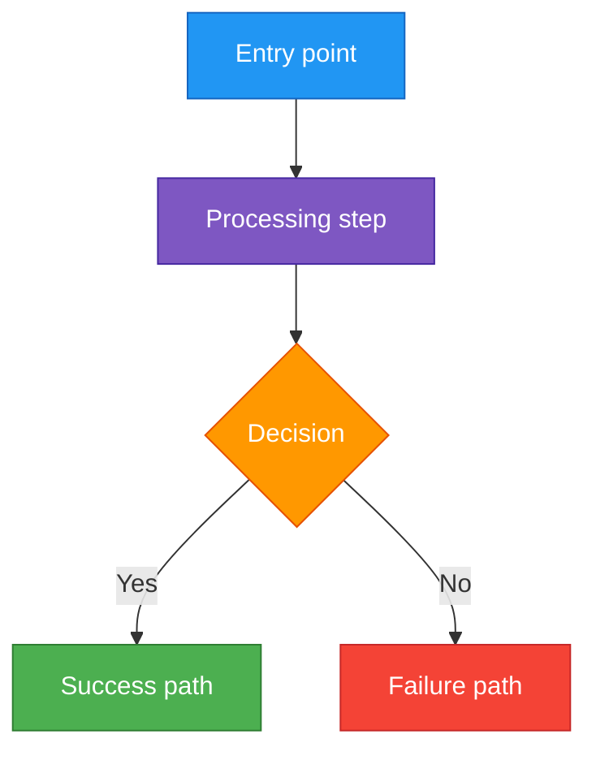
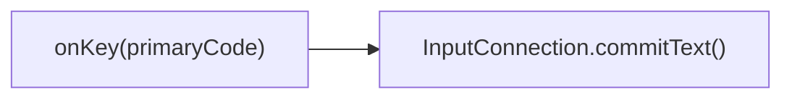

The template below is to be used as a guideline, use to suit the current task the best.

# TASK-XXX: Task name
Created using task template in docs/tasks/task_template.md

## Full initial request (verbatim)

Paste the user's **original task request word-for-word** here (as a blockquote), before any
analysis or paraphrasing. This is the unedited source of intent — preserve typos, item
numbering, and asides. Capture it as the **first action** when the task file is created.

> (verbatim request goes here)

## Overview

Short task overview

## User decisions (precise wording)

Capture scope/design answers from the user **verbatim** as they arrive (planning Q&A, mid-task corrections). These are the requirements source of truth — quote, don't paraphrase; bold the operative parts. Add rows as decisions land; if a later decision supersedes an earlier one, keep both and mark the old one ~~struck through~~.

| Topic | Decision (user's words) |
|---|---|
| Short topic label | "Exact quote, with **operative parts bolded**." → resolved to *X* (only when the quote needs interpretation) |

## Design principles
- **No backwards compatibility** - Clean implementation, update all code in place
- KISS
- Elegant
- No new 3rd-party dependencies without explicit user approval (ask before implementing a solution that needs one)

---

## Current analysis

### Current Flow

In words, mermaid charts. Use colors to distinguish node types:



Color guide for flowcharts:
- **Blue** `#2196F3` -- entry points, triggers, user actions
- **Purple** `#7E57C2` -- processing/transformation steps
- **Orange** `#FF9800` -- decision points, checks, gates
- **Green** `#4CAF50` -- success paths, new additions
- **Red** `#F44336` -- failures, drops, errors
- **Magenta** `#9C27B0` -- data/persistence operations

Note: Use `"quotes"` around node text containing special chars like `{}/:` to avoid parse errors:


Explain issues

### What needs improving
Explain, show mermaid charts

### Initial solution [to be removed after choosing solution]

Describe the first approach that comes to mind. Include what changes, where, and any risks or trade-offs you notice.

### Alternative solutions [to be removed after choosing solution]

Provide 2-4 alternatives. Describe each **without leading language** — don't signal which one you prefer. For each:
- What it does (mechanism)
- What changes and where (scope)
- Known risks or edge cases

### Solution evaluation [to be removed after choosing solution]

Evaluate **each** solution (including the initial one) on the same set of metrics. Write a paragraph per solution covering:
- Performance
- Correctness / edge case risk
- Maintainability
- Code locality (how many files/methods touched)
- Consistency with existing codebase patterns

Then provide a **scoring table** at the end. Write it as a bare GitHub-flavored markdown table — **do not** wrap it in a ```` ```markdown ```` fence, or it will render as literal text instead of a table:

Scale: 1 (worst) to 5 (best)

| Metric | Solution A | Solution B | Solution C | ... |
|--------|:-:|:-:|:-:|:-:|
| Performance | N | N | N | ... |
| Correctness | N | N | N | ... |
| Maintainability | N | N | N | ... |
| Code locality | N | N | N | ... |
| Codebase consistency | N | N | N | ... |
| Simplicity of change | N | N | N | ... |
| **Total** | **N** | **N** | **N** | ... |

### Chosen solution implementation details

Propose to the user the solutions, give 1-2 sentences on each. Let them evaluate and ask questions. After they confirm, delete other sections of choices and other solutions, include key decisions and this:
- **Why this over alternatives** (1-3 sentences referencing the key differentiators)
- **What to change** (file paths, method names, pseudocode-level description of the change)
- **Existing patterns to follow** (link to similar code already in the codebase)
- **Edge cases** (how each is handled)
- **Files to modify** (table with file, change description, status)
- Mermaid charts

## Subtasks

Detailed subtask documentation in: `docs/tasks/task_xxx_subtasks/`

| ID | Description | Status | File |
|----|-------------|--------|------|

NOTES: If asked, you can create task file even in plan mode. Just do it.

## Instructions

- Before making any code change, give the user a concise (1-2 sentence) explanation of what is being changed and why.
- Make sure to always run tests, no new broken tests or errors are allowed. Must be 0. Let the user know if any still remain and let them know you'll fix them
- **Running tests:**
  - Bazel (TypeScript and some Java): `bazel test //...` (or a narrower target).
  - Gradle (Android code under `ime/`, `api/`, `addons/`): `./gradlew :[path]:[to]:[module]:testDebugUnitTest`, e.g. `./gradlew :ime:base-rx:testDebugUnitTest`.
  - In `:ime:app` **always** filter with `--tests`, e.g. `./gradlew :ime:app:testDebugUnitTest --tests "com.anysoftkeyboard.keyboards.views.preview.KeyPreviewsManagerTest"`.
  - Never use the Gradle `build` task — use `assembleDebug` to build.
- **Monitoring a test run:**
  - **Do:** start long runs with the Bash tool's `run_in_background: true` and a hardcoded log name: `./gradlew ... 2>&1 | tee scratch/test_runs/test_run_YYYYMMDD_HHMMSS.txt`. The harness tells you when that command exits, so that is the whole monitor. A foreground call with `timeout: 600000` also works.
  - **Do:** read the result from the log (`BUILD SUCCESSFUL` / `BUILD FAILED`, `tests completed, N failed`, Bazel's `Executed N out of M tests: ... fail`). The exit status of a `| tee` pipeline is `tee`'s, so a failed run still reports success.
  - **Do:** look before you answer. When asked whether a run is still going, or when a notification is more than a few minutes late, check the log's modified time and its last lines, then say what you saw.
  - **Don't:** start tests with `nohup ... &` and add a second watcher. The harness can't see a detached run, so nothing tells you when it ends.
  - **Don't:** wait with `while pgrep -f gradlew`. The pattern matches the waiting shell's own command line, so the loop never ends. The same goes for any `pgrep -f`, `pkill -f` or `ps | grep` whose text sits in its own command.
  - **Don't:** wait without a deadline. If you must wait on a process you didn't start, use its PID with a limit: `timeout 900 tail --pid=<pid> -f /dev/null`.
  - **Don't:** tell the user a run is "still running" from memory, or end a turn waiting on a watcher you haven't checked.
  - **Don't:** keep output only behind `| tail` or `| grep`. Always write the full log to `scratch/test_runs/`.
  - **If the log stops growing** for several minutes before the summary line, the run has wedged. Kill the process tree (`./gradlew --stop` for the daemon), then re-run the stuck tests alone.
- Don't fix lint/format issues by hand — run the auto-fixers with `bazel run //:format` (applies to all code).
- Temporary files (scripts, data, logs) go under `scratch/` (gitignored).
- Tests follow project conventions: TypeScript `[file].test.ts` with the `node` test runner; Java/Kotlin `[File]Test.java`. Prefer fakes over mocks/patches unless mocking is simpler.
- Use inclusive naming (no "dummy", "blacklist", "whitelist", "master", "slave", etc.; gender-neutral pronouns).
- **On-device testing must never touch the user's installed AnySoftKeyboard or its settings.**
  Debug builds share the store app id (`com.menny.android.anysoftkeyboard`), so:
  - Build the keyboard with an app-id *suffix* through a Gradle init script kept in `scratch/` (no repo change):
    `plugins.withId('com.android.application') { if (project.path == ':ime:app') android.buildTypes.debug.applicationIdSuffix = '.dev' }`,
    then `./gradlew --init-script scratch/<name>.init.gradle :ime:app:assembleDebug`.
    Don't use `-Poverride_app_id`: it also renames the R namespace and breaks the build.
  - Install only with `adb install -r`. Never `adb uninstall`, `pm clear` or a plain `installDebug` on the
    store app id. Remove the dev copy only by its suffixed id, and ask first.
  - Language/theme packs that are already on the phone from the store need the same treatment (suffix their app ids).
  - Wireless adb (Android 11+): Developer options → Wireless debugging → *Pair device with pairing code*;
    on the PC `adb pair IP:PAIR_PORT`, then `adb connect IP:PORT` (a different port). If the phone hosts the hotspot
    and wireless debugging is greyed out, use USB once: `adb tcpip 5555`, then `adb connect <gateway-ip>:5555`.
  - Screenshots: `adb exec-out screencap -p > scratch/screenshots/<name>.png`. Avoid emulators on low-RAM machines.
- If UI/UX changed, make sure to show specific changes and give paths to screenshots (from the device, under `scratch/screenshots/`).
  - **Any redesign → mockups, then STOP and wait for the user's pick.** A request to redesign or restyle a screen/keyboard element ("make it nicer", "looks clunky/outdated"), or a new UI element with no reference, is never implemented straight away. Make the mockups, show them, record the options in the progress file, and **end the turn awaiting the user's choice**. Do not edit the real layouts/styles for that element until they pick (logic that doesn't depend on the layout may continue). If a mid-task message adds a redesign to scope, park that part the same way.
  - **Unclear design → mock up first, don't guess.** Build **3–5 distinct options** and include the **expanded/open states** (popups, menus, dialogs), not just the closed view. Present each with a one-line description and a recommendation, and let the user pick or combine. Then implement only the chosen design and record the choice verbatim in "User decisions".

### Gotchas (learned the hard way)

- (add project-specific gotchas here as they are discovered)

## Commit suggestion

At the end of every task or subtask, emit a **Suggested commit** block with a ready-to-paste `git commit`. Never run it. Before suggesting it, run `bazel run //:format` and make sure all relevant unit tests pass.

**Shape:** `[LLM] TASK-<id> <type>(<scope>): <specific subject>` — imperative, names the surface, no period. No AI attribution/signatures in the message.

**Grow the body only when the subject leaves something out.** Let these three examples be the spec.

> **Form:** use **repeated `-m` flags** — each `-m` becomes a blank-line-separated paragraph. Works in fish, bash, and zsh. Avoid bash heredocs (`<<'EOF'`): they don't work in fish.

Trivial fix — subject says everything:
```
git commit -m "[LLM] TASK-216 fix(keyboard): Correct key preview offset in landscape"
```

Small diff, but the *why* isn't in the code — add one `Why:` line:
```
git commit \
  -m "[LLM] TASK-215 refactor(clipboard): Close clipboard popup on keyboard hide" \
  -m "Why: Popup stayed visible over the next app after the IME was dismissed."
```

Multi-concern or design-heavy — `Why:` plus bullets (bullets go in one `-m` so the blank line separating them from the Why stays intact):
```
git commit \
  -m "[LLM] TASK-217 feat(tasks): Wire commit suggester into task template" \
  -m "Why: Standardize post-task commits and preserve motivation that the diff alone can't show." \
  -m "- Append commit-suggestion section to docs/tasks/task_template.md
- Gate body growth on whether the subject is self-sufficient
- Emit Suggested-commit block at each task/subtask end"
```

**Optional trailers** (only when they add info the subject doesn't):
```
Subtask: 216.3
Tests: 0 failed, 412 passed
```
Skip the `Task:` trailer — it'd repeat the subject. Skip the whole block if nothing applies.

If the subject reads like `Fix height progress` or `Update sys info`, rewrite it before picking a shape — a vague subject isn't a reason to add a body.
